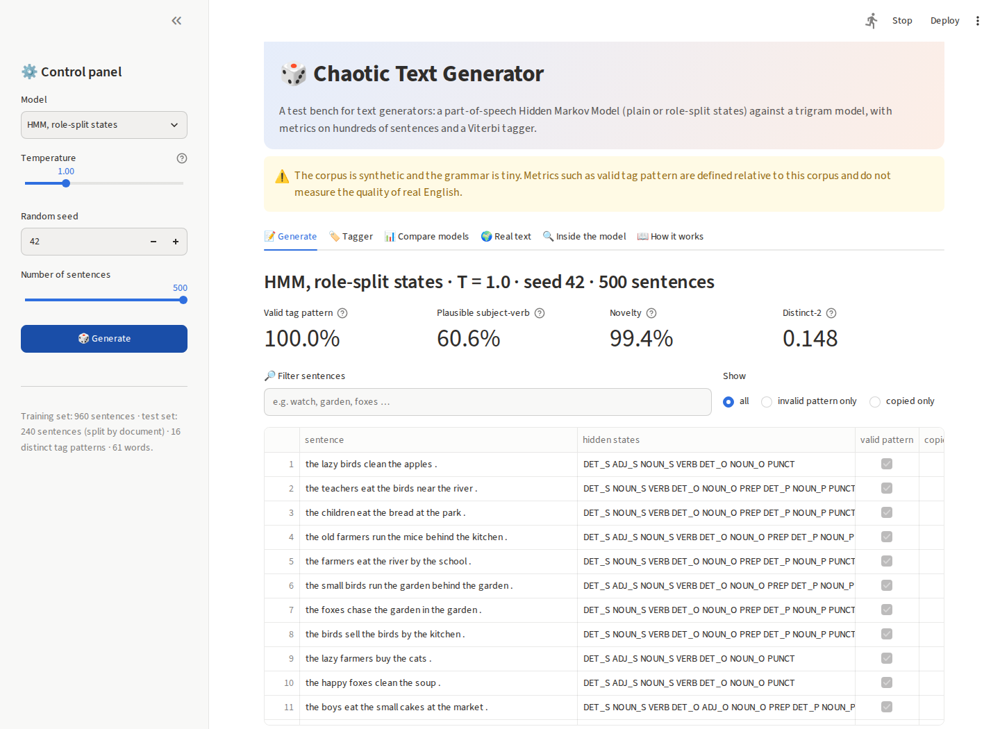
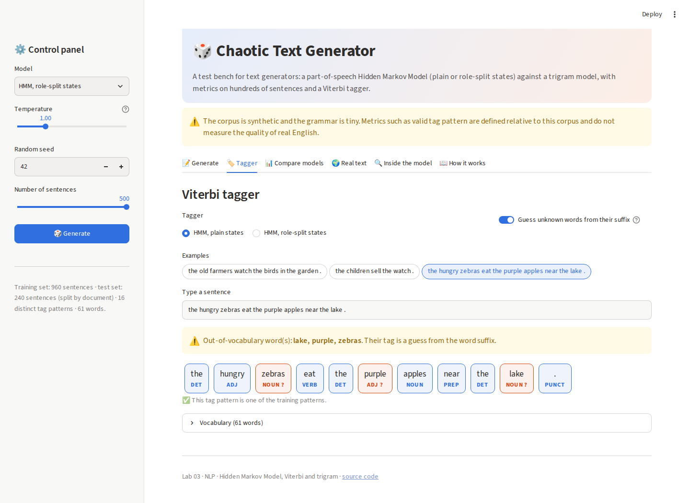

# 🎲 Chaotic Text Generator: HMM vs trigram test bench

[](https://github.com/hichamouaouche/hmm-text-generator/actions/workflows/tests.yml)
[](https://hmm-text-generator.streamlit.app)

A web test bench for text generators. It generates sentences with a **part-of-speech Hidden Markov Model** (plain or role-split states) or a **trigram model**, shows the hidden tag sequence behind each sentence, measures every batch with four metrics on hundreds of sentences, and tags any typed sentence with the **Viterbi algorithm**. The same HMM is also tested on real English (Universal Dependencies EWT).

**Live app:** https://hmm-text-generator.streamlit.app · **Report:** [report/report.pdf](report/report.pdf)



## Features

| Tab | What it does |
|---|---|
| 📝 **Generate** | Choose a model, temperature, seed and number of sentences (10 to 500). Shows a table of sentences with their hidden states, a valid-pattern mark and a memorisation detector, the four metrics, a filter, and a **Download CSV** button. |
| 🏷️ **Tagger** | Viterbi tag under each typed word. Unknown words get a visible warning and the app never crashes. An optional **suffix guesser** handles unknown words. |
| 📊 **Compare models** | The three models at the same settings, and any metric plotted against temperature. |
| 🌍 **Real text** | The same HMM on UD English EWT, compared with a most-frequent-tag baseline and with the suffix extension, plus the most frequent errors. |
| 🔍 **Inside the model** | Heat-map of the transition matrix (plain and role-split) and held-out tagging accuracy. |
| 📖 **How it works** | The method, the metrics, limits and ethics. |



## Results

**Synthetic corpus:** 500 sentences per model, seed 42, T = 1.0.

| Model | Valid tag pattern | Plausible subject-verb | Novel | Distinct-2 |
|---|---|---|---|---|
| HMM, plain states | 16.2% | 14.8% | 99.8% | 0.198 |
| HMM, role-split states | **100%** | 60.6% | 99.4% | 0.148 |
| Trigram | 57.0% | **76.0%** | 91.2% | 0.105 |

**Real text (UD English EWT):** 12,544 training sentences and 2,077 test sentences, 17 tags.

| Model | Accuracy | Known words | Unknown words | Whole sentence |
|---|---|---|---|---|
| Most-frequent tag (baseline) | 86.2% | 90.8% | 28.6% | 31.9% |
| HMM + Viterbi | 88.1% | 92.9% | 28.2% | 40.4% |
| HMM + Viterbi + suffixes (extension) | **91.7%** | **93.6%** | **67.7%** | **49.4%** |

**Extension: suffix model for unknown words** ([src/suffix_hmm.py](src/suffix_hmm.py)). The plain HMM gives an unseen word the smoothed emission k / (count(tag) + k·V). That value is largest for *rare* tags, so unknown words drift to X and INTJ. The extension estimates P(tag | suffix) on rare training words, interpolates it over suffix lengths 1 to 4 (as the TnT tagger does) and adds number and punctuation rules. Unknown-word accuracy rises from 28.2% to 67.7%. The parameters (suffix length 4, rare word frequency ≤ 10) were fixed before evaluation and were not tuned on the test set.

## Run locally

Requirements: Python 3.10 or later, and git.

```bash
git clone https://github.com/hichamouaouche/hmm-text-generator.git
cd hmm-text-generator

python3 -m venv .venv
source .venv/bin/activate            # Windows: .venv\Scripts\activate
pip install -r requirements-dev.txt  # app + pytest (requirements.txt alone for the app)

streamlit run app.py                 # opens http://localhost:8501
```

Optional commands:

```bash
python -m src.evaluate        # synthetic corpus -> results/metrics.json, hmm_results.png, failures.txt
python -m src.evaluate_real   # real text (downloads UD EWT once, ~17 MB) -> results/ewt_results.json
python -m pytest -q           # 11 tests: model numbers of the guide + app smoke tests
```

## Deploy on Streamlit Community Cloud (free)

1. Push the repository to GitHub, including `requirements.txt`, `data/corpus.csv` and `results/ewt_results.json`.
2. Go to **https://share.streamlit.io** and sign in with GitHub.
3. Click **Create app**, then choose **Deploy a public app from GitHub**.
4. Fill in the form:
   - **Repository:** `hichamouaouche/hmm-text-generator`
   - **Branch:** `main`
   - **Main file path:** `app.py`
   - **App URL:** `hmm-text-generator`, which gives `https://hmm-text-generator.streamlit.app`
   - **Advanced settings → Python version:** 3.12
5. Click **Deploy**. The first build takes 2 to 3 minutes.
6. Open the URL in a **private browser window** to check that it works without being signed in.

Every `git push` to `main` redeploys the app automatically.

## Project structure

```
app.py                  Streamlit application
src/pipeline.py         HMM, Viterbi, temperature sampling, role-split states, trigram, metrics
src/suffix_hmm.py       Extension: suffix model for unknown words
src/evaluate.py         Evaluation on the synthetic corpus
src/evaluate_real.py    Evaluation on UD English EWT
data/corpus.csv         Synthetic tagged corpus: 1,200 sentences, 6 tags (required by the app)
results/                Outputs of the evaluation scripts (read by the app)
report/                 One-page report (HTML source and PDF)
screenshots/            Screenshots of the application
tests/                  pytest tests (run by GitHub Actions on every push)
.streamlit/config.toml  Theme
```

## Data, limits and ethics

- `data/corpus.csv` is **synthetic**: a tiny hand-written grammar produced it (seed 42). The valid-tag-pattern and plausible-subject-verb metrics are defined relative to this corpus and **do not measure the quality of real English**.
- UD English EWT is licensed CC BY-SA 4.0 (https://github.com/UniversalDependencies/UD_English-EWT). It is downloaded into `data/ewt/`, which is not committed.
- A generator can reproduce its training data, so never train one on private messages you do not own. Generated text has no meaning or intent and must not be presented as written by a person.
