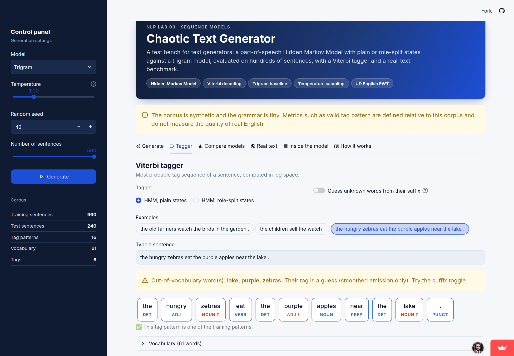

# Chaotic Text Generator : banc d'essai HMM contre trigramme

[](https://github.com/hichamouaouche/hmm-text-generator/actions/workflows/tests.yml)
[](https://hmm-text-generator.streamlit.app)

**Mini-rapport du Lab 03 (module NLP)**
Hicham Ouaouche · Encadrant : Pr. Zakariae EN-NAIMANI · ENSET Mohammedia, Université Hassan II de Casablanca

| Livrable | Lien |
|---|---|
| Application publique | https://hmm-text-generator.streamlit.app |
| Dépôt GitHub | https://github.com/hichamouaouche/hmm-text-generator |

> **Avertissement :** le corpus est synthétique et la grammaire est minuscule. Les métriques comme *valid tag pattern* sont définies par rapport à ce corpus et ne mesurent pas la qualité de l'anglais réel.

---

## Sommaire

1. [Objectif du projet](#1-objectif-du-projet)
2. [Problème et solution](#2-problème-et-solution)
3. [Application web](#3-application-web)
4. [Résultats à T = 1,0](#4-résultats-à-t--10)
5. [Choix de la température](#5-choix-de-la-température)
6. [Une bonne et une mauvaise phrase](#6-une-bonne-et-une-mauvaise-phrase)
7. [Ce que le découpage d'états change, et ce qu'il ne change pas](#7-ce-que-le-découpage-détats-change-et-ce-quil-ne-change-pas)
8. [Test sur texte réel](#8-test-sur-texte-réel)
9. [Exécution en local](#9-exécution-en-local)
10. [Déploiement](#10-déploiement)
11. [Structure du projet](#11-structure-du-projet)
12. [Limites et éthique](#12-limites-et-éthique)

---

## 1. Objectif du projet

Ce projet est un **banc d'essai pour générateurs de texte**, sous forme d'application web Streamlit. Il permet de :
- générer des phrases avec trois modèles : un **HMM sur les étiquettes morphosyntaxiques** (états simples ou états scindés par rôle) et un **trigramme** ;
- mesurer chaque lot de phrases avec **quatre métriques automatiques** ;
- étiqueter une phrase saisie avec l'**algorithme de Viterbi** ;
- comparer les résultats du corpus synthétique à ceux du **texte réel** (UD English EWT).

Le banc d'essai fournit les éléments pour choisir un générateur et une température, par exemple pour un jouet d'écriture ou une autocomplétion.

## 2. Problème et solution

**Le problème.** Une phrase générée n'a pas de réponse de référence. Juger un générateur sur trois exemples ne prouve rien : il faut des métriques automatiques calculées sur des centaines de phrases. De plus, un HMM du premier ordre ne sait pas si un NOM est le sujet ou le complément. Après un NOM, le tag suivant est VERB avec une probabilité de 0,39, PREP avec 0,22 et PUNCT avec 0,39, quel que soit le rôle du nom.

**La solution, en 5 lignes :**
1. On estime un HMM supervisé par comptage sur 960 phrases d'entraînement. Le découpage se fait par document, avant tout comptage.
2. On génère une séquence de tags, puis un mot par tag. La température transforme les poids en `count^(1/T)`.
3. On scinde NOUN, ADJ et DET en états S (sujet), O (objet) et P (groupe prépositionnel), pour que le modèle sache où il se trouve dans la phrase.
4. On compare le HMM à un trigramme sur 500 phrases par réglage (graine 42), avec 4 métriques : valid tag pattern, plausible subject-verb, novelty et distinct-2.
5. On étiquette avec Viterbi en log-probabilités, avec un lissage add-k (k = 0,01).

## 3. Application web

L'application répond aux six exigences de l'énoncé :

| Exigence de l'énoncé | Dans l'application |
|---|---|
| 1. Panneau de contrôle | Barre latérale : modèle (HMM simple, HMM par rôle, trigramme), température (0,3 à 3), graine, nombre de phrases (10 à 500) |
| 2. Bouton Generate et tableau | Une ligne par phrase : les mots, la séquence de tags cachés et une coche « motif valide » |
| 3. Panneau de métriques | Valid tag pattern, plausible subject-verb, novelty et distinct-2 du lot généré |
| 4. Tagger | Le tag Viterbi s'affiche sous chaque mot. Un mot inconnu déclenche un avertissement visible, sans plantage |
| 5. Download CSV | Export des phrases générées |
| 6. Avertissement visible | Le texte exact de l'énoncé, en haut de la page |
| Optionnel | Tableau comparatif des 3 modèles et courbe du valid tag pattern selon la température |

| Génération (HMM à états par rôle) | Tagger avec mots inconnus |
|---|---|
|  |  |

D'autres captures de l'application déployée se trouvent dans [screenshots/](screenshots/).

## 4. Résultats à T = 1,0

500 phrases par modèle, graine 42 :

| Modèle | Valid tag pattern | Plausible subject-verb | Novelty | Distinct-2 |
|---|---|---|---|---|
| HMM, états simples | 16,2 % | 14,8 % | 99,8 % | 0,198 |
| HMM, états par rôle | **100 %** | 60,6 % | 99,4 % | 0,148 |
| Trigramme | 57,0 % | **76,0 %** | 91,2 % | 0,105 |

**Pourquoi le HMM simple obtient un score bas.** Le tag suivant ne dépend que du tag précédent. Après un NOUN, le modèle peut donc :
- tirer PUNCT juste après le sujet, ce qui donne « the quiet school . » ;
- tirer un second VERB après l'objet, ce qui donne « the boys visit the rice sell the young farmers . ».

Seules 16,2 % des séquences générées font partie des 16 motifs vus à l'entraînement.

**Pourquoi le HMM par rôle obtient 100 %.** Les états NOUN_S, NOUN_O et NOUN_P encodent la position dans la phrase :
- NOUN_S est toujours suivi d'un VERB ;
- NOUN_O est suivi d'une PREP ou d'un PUNCT ;
- NOUN_P est suivi d'un PUNCT.

Chaque chemin dans les états reproduit donc l'un des motifs d'entraînement. Le modèle reste pourtant d'ordre 1.

**Étiquetage.** Viterbi atteint 100 % sur les 240 phrases de test pour les deux HMM. Le mot ambigu *watch* (NOUN ou VERB) est bien étiqueté 37 fois sur 37.

## 5. Choix de la température

Taux de motifs valides selon la température (500 phrases par réglage) :

| Modèle | T = 0,5 | T = 1,0 | T = 1,5 | T = 2,5 |
|---|---|---|---|---|
| HMM, états simples | 23,8 % | 16,2 % | 20,4 % | 15,4 % |
| HMM, états par rôle | 100 % | 100 % | 100 % | 100 % |
| Trigramme | 63,6 % | 57,0 % | 48,2 % | 44,2 % |

- **Jouet d'écriture : HMM par rôle à T = 1,5.** La structure reste à 100 % et la diversité augmente (distinct-2 de 0,148 à 0,161), ce qui donne des phrases variées mais grammaticales.
- **Autocomplétion : trigramme à T = 0,5.** C'est le réglage le plus sûr et le plus prévisible : 79,2 % de paires sujet-verbe plausibles et 63,6 % de motifs valides.

## 6. Une bonne et une mauvaise phrase

| | Phrase | Modèle | Type d'échec et cause |
|---|---|---|---|
| Bonne | « the children eat the bread at the park . » | HMM par rôle, T = 1,0 | Aucun échec : le motif est valide, la paire (children, eat) existe à l'entraînement, et la phrase est nouvelle |
| Mauvaise | « the boys visit the rice sell the young farmers . » | HMM simple, T = 1,0 | **Structure.** Deux verbes : après le NOUN objet « rice », le modèle tire VERB, parce qu'il ne sait pas que ce nom est l'objet |

Deux autres types d'échec apparaissent aussi :
- **Sens :** « the foxes lose by the school . » (HMM par rôle). Le motif est valide, mais la paire (foxes, lose) n'existe jamais, parce que le verbe est émis indépendamment du sujet.
- **Mémorisation :** « the girls leave the park . » (trigramme, T = 0,5). C'est une copie exacte d'une phrase d'entraînement, pas de la créativité.

## 7. Ce que le découpage d'états change, et ce qu'il ne change pas

Le découpage d'états **change la structure**. Le taux de motifs valides passe de 16,2 % à 100 %, à toutes les températures, sans changer l'ordre du modèle. La nouveauté est préservée (99,4 %) et l'étiquetage reste à 100 %.

Il **ne change pas le sens**. Les mots sont toujours émis indépendamment les uns des autres une fois l'état connu. La plausibilité sujet-verbe (60,6 %) reste donc sous celle du trigramme (76,0 %), qui voit les vrais mots précédents. La diversité baisse aussi : distinct-2 passe de 0,198 à 0,148.

C'est un résultat négatif à rapporter : 100 % de structure ne signifie pas 100 % de qualité.

## 8. Test sur texte réel

Le même HMM est évalué sur UD English EWT : 12 544 phrases d'entraînement, 2 077 phrases de test, 17 tags. On lance l'évaluation avec `python -m src.evaluate_real`.

| Modèle | Précision | Mots connus | Mots inconnus | Phrase entière correcte |
|---|---|---|---|---|
| Synthétique : HMM + Viterbi | 100 % | 100 % | — | 100 % |
| EWT : tag le plus fréquent (baseline) | 86,2 % | 90,8 % | 28,6 % | 31,9 % |
| EWT : HMM + Viterbi | 88,1 % | 92,9 % | 28,2 % | 40,4 % |

**Explication de l'écart.** La grammaire synthétique est minuscule et régulière : 6 tags, 61 mots, 16 motifs. Une fois le tag précédent connu, elle n'est presque plus ambiguë, d'où les 100 %. Le texte réel est très différent :
- il compte 17 tags, 16 654 mots différents et 10 359 séquences de tags distinctes ;
- 7,5 % des tokens de test sont des mots inconnus, et seuls 28,2 % d'entre eux sont bien étiquetés.

Pour un mot inconnu, l'émission lissée `k / (count(tag) + k·V)` est la plus grande pour les tags **rares**. Les noms propres partent donc vers X ou INTJ. Le HMM ne gagne que 1,9 point sur la baseline, et le *valid tag pattern* n'a plus de sens sur du texte réel.

**Extension proposée.** Le fichier [src/suffix_hmm.py](src/suffix_hmm.py) devine le tag d'un mot inconnu d'après son suffixe :
- il estime `P(tag | suffixe)` sur les mots rares de l'entraînement, avec des suffixes de 1 à 4 lettres, comme le tagger TnT ;
- ses paramètres ont été fixés avant l'évaluation, sans réglage sur le test.

Sur EWT, la précision passe de 88,1 % à **91,7 %**, et celle sur les mots inconnus de 28,2 % à **67,7 %**.

## 9. Exécution en local

**Prérequis :** Python 3.10 ou plus récent, et git.

```bash
git clone https://github.com/hichamouaouche/hmm-text-generator.git
cd hmm-text-generator
python3 -m venv .venv
source .venv/bin/activate            # Windows : .venv\Scripts\activate
pip install -r requirements-dev.txt
streamlit run app.py                 # http://localhost:8501
```

Commandes complémentaires :

```bash
python -m src.evaluate        # corpus synthétique -> results/metrics.json, hmm_results.png, failures.txt
python -m src.evaluate_real   # texte réel (télécharge UD EWT une fois) -> results/ewt_results.json
python -m pytest -q           # 11 tests : chiffres de l'énoncé et application
```

## 10. Déploiement

L'application est hébergée sur **Streamlit Community Cloud**. Le dépôt contient les trois fichiers nécessaires au démarrage : `requirements.txt`, `data/corpus.csv` et `results/ewt_results.json`.

1. Ouvrez https://share.streamlit.io, connectez-vous avec GitHub et cliquez sur **Create app**.
2. Choisissez le dépôt `hichamouaouche/hmm-text-generator`, la branche `main` et le fichier `app.py`.
3. Cliquez sur **Deploy**.

Chaque `git push` sur `main` redéploie l'application et lance les tests GitHub Actions. L'URL a été testée dans une fenêtre de navigation privée.

## 11. Structure du projet

```
app.py                  Application Streamlit
src/pipeline.py         HMM, Viterbi, température, états par rôle, trigramme, métriques
src/suffix_hmm.py       Extension : suffixes pour les mots inconnus
src/evaluate.py         Évaluation sur le corpus synthétique
src/evaluate_real.py    Évaluation sur UD English EWT
data/corpus.csv         Corpus synthétique étiqueté (1 200 phrases, 6 tags)
results/                Résultats des évaluations
screenshots/            Captures de l'application déployée
tests/                  Tests pytest (GitHub Actions)
.streamlit/config.toml  Thème de l'application
```

## 12. Limites et éthique

- **Données synthétiques.** Les métriques de structure et de sens sont relatives à une grammaire de 16 motifs.
- **Un seul treebank.** Le test réel porte sur un seul corpus anglais, mis en minuscules.
- **Mémorisation.** Un générateur peut recopier ses données d'entraînement. Il ne faut jamais l'entraîner sur des messages privés dont on n'est pas propriétaire.
- **Pas d'intention.** Un texte généré ne doit pas être présenté comme écrit par une personne.
- **Licence.** UD English EWT est sous licence CC BY-SA 4.0. Le dossier `data/ewt/` n'est pas versionné.
