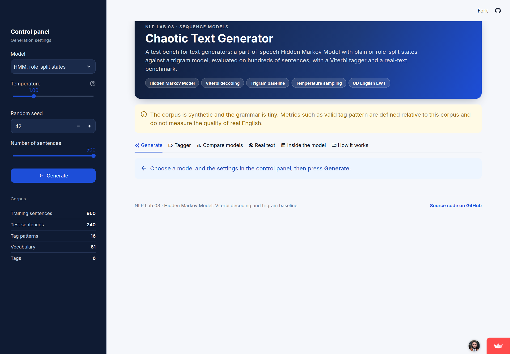
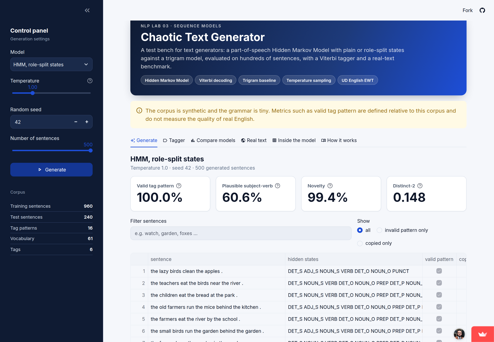
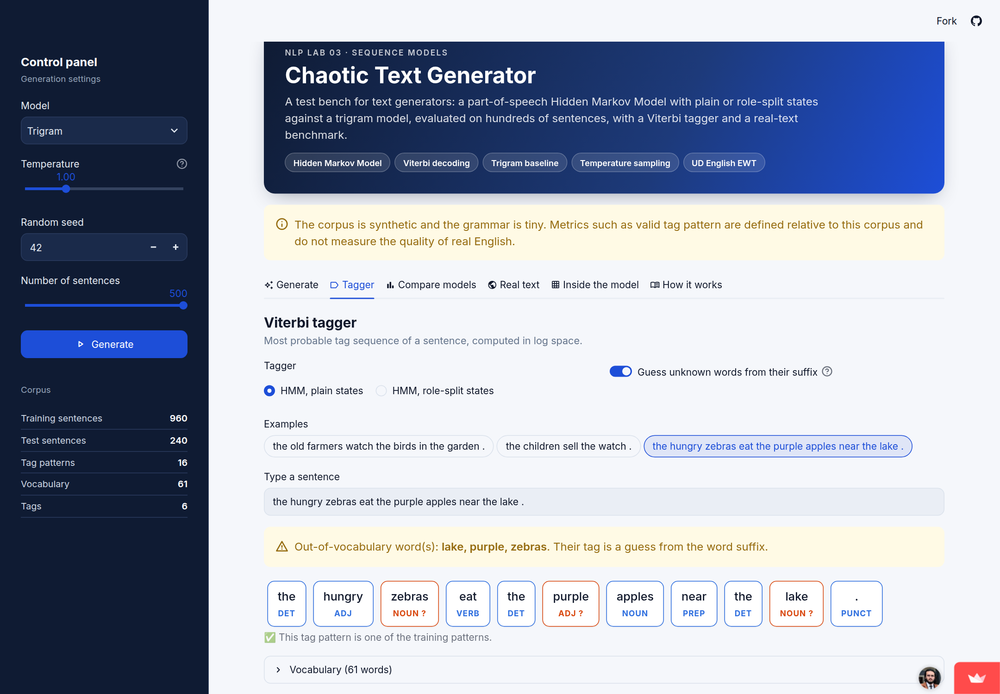
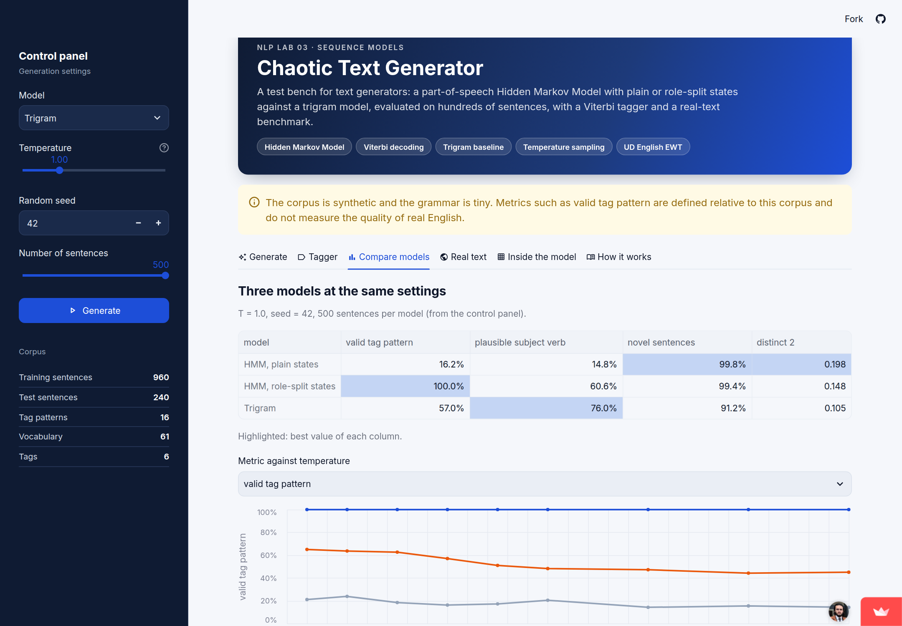
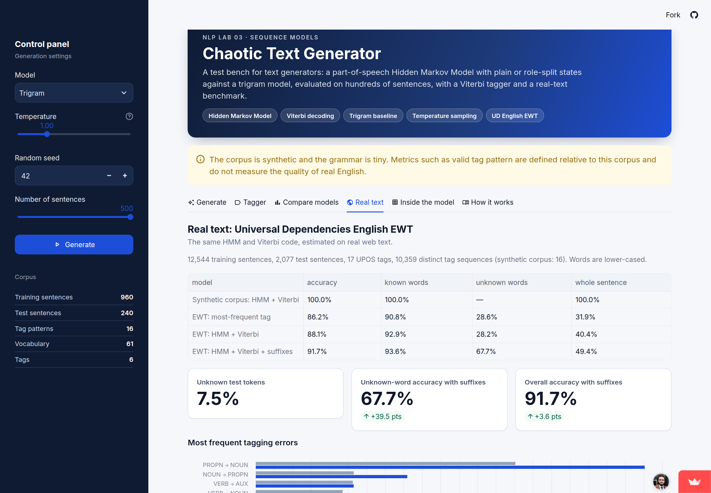

# Chaotic Text Generator : banc d'essai HMM contre trigramme

[](https://github.com/hichamouaouche/hmm-text-generator/actions/workflows/tests.yml)
[](https://hmm-text-generator.streamlit.app)

**Application en ligne :** https://hmm-text-generator.streamlit.app

Cette application web sert de banc d'essai pour des générateurs de texte. Elle génère des phrases avec un **modèle de Markov caché (HMM) sur les étiquettes morphosyntaxiques**, à états simples ou à états scindés par rôle, ou avec un **modèle trigramme**. Pour chaque phrase, elle affiche la séquence d'états cachés. Elle mesure la qualité de chaque lot de phrases avec quatre métriques, et étiquette n'importe quelle phrase saisie avec l'**algorithme de Viterbi**. Le même HMM est aussi évalué sur du texte réel (Universal Dependencies English EWT).

> **Avertissement :** le corpus est synthétique et la grammaire est minuscule. Les métriques comme *valid tag pattern* sont définies par rapport à ce corpus et ne mesurent pas la qualité de l'anglais réel.



---

## Sommaire

1. [Problème et solution](#1-problème-et-solution)
2. [Fonctionnalités de l'application](#2-fonctionnalités-de-lapplication)
3. [Résultats](#3-résultats)
4. [Exécution en local](#4-exécution-en-local)
5. [Déploiement sur Streamlit Community Cloud](#5-déploiement-sur-streamlit-community-cloud)
6. [Structure du projet](#6-structure-du-projet)
7. [Méthode](#7-méthode)
8. [Limites et éthique](#8-limites-et-éthique)

---

## 1. Problème et solution

**Le problème.** Une phrase générée n'a pas de réponse de référence. Juger un générateur sur trois exemples qui « ont l'air bien » ne prouve donc rien : il faut des métriques automatiques calculées sur des centaines de phrases. Un HMM du premier ordre a de plus une mémoire très courte. Après un NOM, il ne sait pas si ce nom est le sujet (un verbe doit suivre) ou le complément (une préposition ou un point doit suivre).

**La solution.**
- On estime un HMM supervisé par simple comptage sur 960 phrases d'entraînement étiquetées avec 6 tags. Il n'y a pas de boucle d'apprentissage.
- On génère une séquence d'états, puis un mot par état, avec une température : les poids d'échantillonnage valent `count^(1/T)`.
- On compare trois générateurs : le HMM à états simples, le HMM à états scindés par rôle (S/O/P) et un trigramme.
- On décode avec Viterbi en espace logarithmique, avec un lissage add-k (k = 0,01).

## 2. Fonctionnalités de l'application

| Onglet | Contenu |
|---|---|
| **Generate** | Choix du modèle, de la température (0,3 à 3), de la graine et du nombre de phrases (10 à 500). Tableau des phrases avec les états cachés, l'indicateur « motif valide » et le détecteur de copie (mémorisation). Quatre métriques, filtres, et bouton **Download CSV**. |
| **Tagger** | Le tag Viterbi apparaît sous chaque mot saisi. Un mot inconnu déclenche un avertissement visible, sans plantage. En option, les mots inconnus sont devinés d'après leur **suffixe** (extension). |
| **Compare models** | Les 3 modèles avec les mêmes réglages, et la courbe de n'importe quelle métrique en fonction de la température. |
| **Real text** | Le HMM sur UD English EWT, comparé à la baseline « tag le plus fréquent » et à l'extension suffixes, avec les erreurs les plus fréquentes. |
| **Inside the model** | La carte de chaleur des transitions (états simples et états par rôle) et la précision de l'étiquetage sur le jeu de test. |
| **How it works** | La méthode, les définitions des métriques, les limites et l'éthique. |

| Génération (HMM à états par rôle) | Tagger avec mots inconnus |
|---|---|
|  |  |
| **Comparaison des modèles** | **Texte réel (EWT)** |
|  |  |

## 3. Résultats

### 3.1 Corpus synthétique (500 phrases par modèle, graine 42, T = 1,0)

| Modèle | Motif de tags valide | Sujet-verbe plausible | Phrases nouvelles | Distinct-2 |
|---|---|---|---|---|
| HMM, états simples | 16,2 % | 14,8 % | 99,8 % | 0,198 |
| HMM, états par rôle | **100 %** | 60,6 % | 99,4 % | 0,148 |
| Trigramme | 57,0 % | **76,0 %** | 91,2 % | 0,105 |

- **Étiquetage Viterbi sur les 240 phrases de test :** 100 % pour les deux HMM. Le mot ambigu *watch* (NOM ou VERBE) est correctement étiqueté 37 fois sur 37.
- **Effet de la température :** pour le trigramme, le taux de motifs valides passe de 63,6 % à T = 0,5 à 44,2 % à T = 2,5, pendant que la diversité augmente. Le HMM à états par rôle reste à 100 % à toutes les températures.

### 3.2 Texte réel : UD English EWT (12 544 phrases d'entraînement, 2 077 de test, 17 tags)

| Modèle | Précision | Mots connus | Mots inconnus | Phrase entière correcte |
|---|---|---|---|---|
| Tag le plus fréquent (baseline) | 86,2 % | 90,8 % | 28,6 % | 31,9 % |
| HMM + Viterbi | 88,1 % | 92,9 % | 28,2 % | 40,4 % |
| HMM + Viterbi + suffixes (extension) | **91,7 %** | **93,6 %** | **67,7 %** | **49,4 %** |

Les mots inconnus représentent 7,5 % des tokens de test.

**Extension : modèle de suffixes pour les mots inconnus** ([src/suffix_hmm.py](src/suffix_hmm.py)). Dans le HMM de base, l'émission lissée d'un mot inconnu vaut `k / (count(tag) + k·V)`. Cette valeur est la plus grande pour les tags **rares**, si bien que les mots inconnus partent vers X ou INTJ. L'extension estime plutôt `P(tag | suffixe)` sur les mots rares de l'entraînement :
- les suffixes de 1 à 4 lettres sont interpolés, comme dans le tagger TnT ;
- des règles simples traitent les nombres et la ponctuation.

Les paramètres ont été fixés avant l'évaluation, sans réglage sur le jeu de test. La précision sur les mots inconnus passe ainsi de 28,2 % à 67,7 %.

## 4. Exécution en local

**Prérequis :** Python 3.10 ou plus récent, et git.

```bash
# 1. Récupérer le projet
git clone https://github.com/hichamouaouche/hmm-text-generator.git
cd hmm-text-generator

# 2. Créer et activer un environnement virtuel
python3 -m venv .venv
source .venv/bin/activate            # Windows : .venv\Scripts\activate

# 3. Installer les dépendances (application + pytest)
pip install -r requirements-dev.txt

# 4. Lancer l'application
streamlit run app.py
```

L'application s'ouvre sur **http://localhost:8501**. Pour l'arrêter, faites `Ctrl + C` dans le terminal.

**Commandes complémentaires :**

```bash
python -m src.evaluate        # corpus synthétique -> results/metrics.json, hmm_results.png, failures.txt
python -m src.evaluate_real   # texte réel (télécharge UD EWT une fois, ~17 Mo) -> results/ewt_results.json
python -m pytest -q           # 11 tests : chiffres du guide + tests de l'application
```

## 5. Déploiement sur Streamlit Community Cloud

1. Poussez le dépôt sur GitHub. Il doit contenir `requirements.txt`, `data/corpus.csv` et `results/ewt_results.json`.
2. Ouvrez **https://share.streamlit.io** et connectez-vous avec votre compte GitHub.
3. Cliquez sur **Create app**, puis sur **Deploy a public app from GitHub**.
4. Remplissez le formulaire :
   - **Repository :** `hichamouaouche/hmm-text-generator`
   - **Branch :** `main`
   - **Main file path :** `app.py`
   - **App URL :** `hmm-text-generator`
   - **Advanced settings → Python version :** 3.12
5. Cliquez sur **Deploy**. La première construction prend 2 à 3 minutes.
6. Testez l'URL dans une **fenêtre de navigation privée**.

Chaque `git push` sur `main` redéploie l'application automatiquement. Le thème (barre latérale bleu marine, police Inter) est défini dans [.streamlit/config.toml](.streamlit/config.toml).

## 6. Structure du projet

```
app.py                  Application Streamlit (6 onglets)
src/pipeline.py         HMM, Viterbi, échantillonnage avec température, états par rôle, trigramme, métriques
src/suffix_hmm.py       Extension : modèle de suffixes pour les mots inconnus
src/evaluate.py         Évaluation sur le corpus synthétique
src/evaluate_real.py    Évaluation sur UD English EWT
data/corpus.csv         Corpus synthétique étiqueté : 1 200 phrases, 6 tags (nécessaire à l'application)
results/                Sorties des scripts d'évaluation (lues par l'application)
screenshots/            Captures de l'application déployée
tests/                  Tests pytest, exécutés par GitHub Actions à chaque push
.streamlit/config.toml  Thème de l'application
```

## 7. Méthode

**HMM.** Les états cachés sont les tags (DET, ADJ, NOUN, VERB, PREP, PUNCT) et les observations sont les mots. Trois tables sont estimées par comptage :
- les probabilités initiales ;
- les transitions `P(tag | tag précédent)` ;
- les émissions `P(mot | tag)`.

**Génération.** On tire d'abord une séquence de tags, puis un mot par tag. La température `T` transforme les poids en `count^(1/T)` :
- `T < 1` : sortie plus sûre et plus répétitive ;
- `T > 1` : sortie plus variée, avec plus d'erreurs.

**États par rôle.** NOUN, ADJ et DET sont renommés selon leur rôle dans la phrase :
- **S** avant le verbe ;
- **O** après le verbe ;
- **P** dans le groupe prépositionnel.

Le modèle de premier ordre sait ainsi où il se trouve dans la phrase.

**Viterbi.** C'est une programmation dynamique sur les positions et les états. Elle travaille en **log-probabilités** (des sommes plutôt que des produits, donc sans underflow) et utilise un lissage add-k.

**Métriques**, calculées sur tout le lot généré :

| Métrique | Ce qu'elle mesure | Définition |
|---|---|---|
| Valid tag pattern | Structure | La séquence de tags est l'une des 16 séquences vues à l'entraînement |
| Plausible subject-verb | Sens (approximation) | La paire (premier nom, premier verbe) existe dans l'entraînement |
| Novelty | Mémorisation | Part des phrases qui ne sont pas copiées de l'entraînement |
| Distinct-2 | Diversité | Bigrammes distincts divisés par le nombre total de bigrammes |

## 8. Limites et éthique

- **Données synthétiques.** Le corpus est produit par une petite grammaire écrite à la main (graine 42). Les métriques *valid tag pattern* et *plausible subject-verb* sont relatives à cette grammaire.
- **Le 100 % ne se transfère pas.** L'étiquetage atteint 100 % parce que la grammaire synthétique n'est plus ambiguë une fois le tag précédent connu. Sur du texte réel, le même code atteint 88,1 %.
- **Portée du test réel.** Il utilise un seul treebank anglais, mis en minuscules. Un HMM du premier ordre n'est pas un tagger de l'état de l'art.
- **Mémorisation.** Un générateur peut recopier ses données d'entraînement : il ne faut jamais l'entraîner sur des messages privés dont on n'est pas propriétaire.
- **Texte sans intention.** Un texte généré est fluide mais n'a ni sens ni intention : il ne faut pas le présenter comme écrit par une personne.
- **Licence.** UD English EWT est sous licence CC BY-SA 4.0 (https://github.com/UniversalDependencies/UD_English-EWT). Le dossier `data/ewt/` n'est pas versionné.

---

**Auteur :** Hicham Ouaouche · **Encadrant :** Zakariae EN-NAIMANI · ENSET Mohammedia, Université Hassan II de Casablanca
